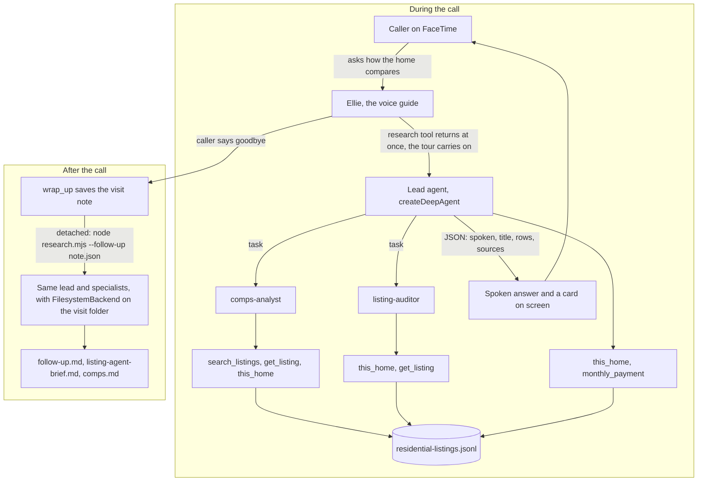

# Deep Agents in Ellie: the research desk behind a live open-house call

**Is Deep Agents doing real work here, or is it a wrapper around one model call?** It is doing real work. The lead agent cannot search the listings itself: only a subagent holds that tool. In the real run quoted below, one comparable home in the output appears nowhere in the guide's own notes, so it can only have come from that subagent's search of the hackathon data. After the call, the same agent is given a folder on disk and writes a three-file follow-up packet into it.

Ellie is an AI open-house guide you call on FaceTime. Her video is a hand-held camera walking through Matterport 360 photos of a real listing, 9530 Alex Springs Lane in Houston. OpenAI Realtime listens and thinks, and ElevenLabs speaks.

## What the desk does for a buyer

A buyer on the call asks something that needs digging: how this home compares with similar ones for sale nearby, what the listing record, the remarks and the scan disagree on, or what the monthly payment would be with their own down payment and rate. The voice model has to start replying in about two seconds, so it cannot stop to search two thousand listings. Ellie says she is having it looked into and carries on with the tour. About twenty seconds later the answer appears as a card on the caller's screen, and she says it aloud in two or three sentences with the source named. When the caller says goodbye, the desk writes a follow-up for the buyer, a brief for the listing agent and a table of comparable homes.

## Why a deep agent and not one model call

The whole agent is one file, `facetime/research.mjs` (209 lines). It is built with `createDeepAgent` from `deepagents` 1.16.5 on `langchain` 1.6.6, and the models load through `@langchain/anthropic` 1.6.5.

| Part | What the code has |
| --- | --- |
| Lead agent | Model `anthropic:claude-sonnet-5-5` (override: `OPEN_HOUSE_RESEARCH_MODEL`). Own tools: `this_home`, `monthly_payment` |
| Subagent `comps-analyst` | Model `anthropic:claude-haiku-5-5` (override: `OPEN_HOUSE_RESEARCH_HELPER`). Tools: `search_listings`, `get_listing`, `this_home` |
| Subagent `listing-auditor` | Same helper model. Tools: `this_home`, `get_listing` |
| Middleware | `todoListMiddleware()` from `langchain`, in both entry points |
| Backend | `FilesystemBackend` on the visit folder, in `followUp` only |
| Entry points | `research(question, slug)` for a live question, `followUp(note, folder, slug)` after a visit |

Each Deep Agents feature we use has a job in the product.

- **Subagents with their own context.** `search_listings` is given to `comps-analyst` and to nobody else, so the lead reaches the wider listings only by delegating through the built-in `task` tool. Each specialist starts with only the task the lead wrote, runs its tool calls on the smaller model, and hands back one short result. The raw search rows never enter the lead's context, which keeps its last step short. The lead's prompt tells it to call both specialists at once when a question needs both.
- **Planning with the todo list.** `todoListMiddleware()` gives the lead `write_todos`. In deepagents 1.16.5 it is not part of the default stack for this model, so the code adds it. The after-call prompt tells the agent to plan with it, because that job is two delegations and three files that have to agree with each other. The live prompt asks for speed instead: "one round of tool calls is usually enough."
- **The file system backend.** After the call the agent gets `new FilesystemBackend({ rootDir: folder, virtualMode: true })`, rooted at that visit's folder. It writes `/follow-up.md`, `/listing-agent-brief.md` and `/comps.md` with the built-in file tools, and they land on disk as files a person can open. With `virtualMode` on, a path that tries to leave the folder is refused. Live questions do not use it: they keep the default in-memory backend and write nothing to disk.
- **Tools over real data.** Four tools built with `tool()` and zod schemas read the kit file `residential-listings.jsonl`. `search_listings` filters by distance, beds, price, size and status. `get_listing` returns one listing's remarks, features and price history. `this_home` joins the home's CoStar record with the guide's notes from the Matterport scan and the Vexcel aerial. `monthly_payment` does the arithmetic, and only with a down payment and rate the caller gave. Every prompt carries the rule "Answer only from tool results", and the search tool attaches a note that these are list prices, so the output says "listed at" and never "sold for".

## The flow



The voice call never waits on the desk. The `research` tool in `facetime/guide.mjs` starts the agent and returns straight away. When the answer arrives, the guide puts the card on screen and is told to present it in no more than three sentences. `wrap_up` saves the visit note as JSON and starts `research.mjs --follow-up` as a detached process, so the packet is finished after the caller has hung up.

**In the demo.** The loop in `Demo-Loop.md` uses the desk twice. At 1:38, right after the price question, the caller asks "How does that compare with similar homes nearby?"; Ellie keeps touring and presents the answer about twenty seconds later. At goodbye, `wrap_up` starts the packet. A judge who takes over the call can ask the desk anything of the same kind.

## Real output

These excerpts are copied from one real run on 15 November 2026 (visit folder `2026-11-15T10-20-06-849Z`). The desk was given the note the guide saved at the end of a run of the demo loop: the caller, Sam, toured five places, liked the kitchen, tried three previews, and wanted the flood zone and roof work checked. Visit folders are not committed to the repository, so these excerpts are the record.

From `follow-up.md`, the message to the visitor (two passages):

> - **Flood zone:** the listing record doesn't say, and I can't find it anywhere else in the data. I'll ask the listing agent to confirm the flood zone and any flood history.
>
> **Worth knowing:** the listing says 1,744 sq ft (CoStar). The scan measures about 1,280 sq ft of rooms, or 1,648 sq ft including the garage (Matterport). The remarks say "3 bedroom", while the record says 4 and the scan shows 4 bedroom-type rooms.

From `listing-agent-brief.md`, three of its thirteen items to confirm:

> | Item | What the record says | What it does not say |
> |---|---|---|
> | Bedrooms | Record: 4 (CoStar). Remarks: "3 bedroom". Scan: 4 bedroom-type rooms (Matterport) | Which count is correct for marketing |
> | Spa | Record flags a spa (CoStar) | None appears in the scan or aerial; please confirm or correct |
> | Taxes | $5,911 a year, 2024 figure (CoStar) | Current tax amount and exemptions |

From `comps.md`, the table and the comparison:

> | Address | Bed/Bath | Listed sq ft (CoStar) | List price | $/sq ft (list price ÷ listed sq ft) | Status | Miles |
> |---|---|---|---|---|---|---|
> | **9530 Alex Springs Ln (this home)** | 4 / 2 | 1,744 | $215,000 | $123 | For sale, listed 6 Oct 2026 | – |
> | 10019 Meadow Mill Forest Ln | 4 / 2 | 1,394 | $218,000 | $156 | Closed 30 Oct 2026 | 0.8 |
> | 10035 Meadow Mill Forest Ln | 3 / 2.5 | 1,798 | $191,000 | $106 | Closed 2 Nov 2026 | 0.8 |
> | 11031 Bauer Elm St | 3 / 2 | 1,754 | $250,000 (last list; first listed at $295,000) | $143 | Closed 20 Aug 2026 | 3.6 |
> | 17114 Hall Shepperd Rd | 4 / 2 | 1,508 | $240,000 | $159 | For sale | 3.5 |
>
> **How it compares:** At $215,000 and 1,744 listed sq ft ($123/sq ft, CoStar), this home sits between the two Meadow Mill Forest homes on list price and is second-lowest of the five on list price per sq ft. The size is the catch: the Matterport scan measures about 1,280 sq ft of rooms, which would be about $168/sq ft, so an appraiser's measurement would settle the comparison.

We recomputed the four comparable homes from `residential-listings.jsonl`. Every price, size, status, close date and distance matches the file. The guide's own notes for this home already name the first three. The fourth, 17114 Hall Shepperd Rd, is in none of the project's notes, so it reached the packet through `search_listings`, which only `comps-analyst` holds. The record-against-scan disagreements are also in the guide's notes; the desk checks them against the listing record and sets them out for this visitor and for the listing agent.

## Run it yourself

You need Node 22.23.2 or newer in the 22 line (or Node 24 or 26), `npm install` done in `facetime/`, an Anthropic key in `facetime/.env.local` as `ANTHROPIC_API_KEY`, and the kit's `residential-listings.jsonl` in `~/brace/data/kit/data/` (or set `OPEN_HOUSE_KIT` to its folder). On the timings below, each command finishes in under a minute.

A live question, through the same `research()` function the guide calls:

```bash
cd facetime
node --env-file=.env.local research.mjs "What similar homes are for sale nearby, and how does this one compare?"
```

It prints the answer as JSON: `spoken` (what Ellie says), `seconds`, and `card` with a title, up to five rows and a source footer. With no question, it asks that same one.

The after-call packet. Save the note below as `facetime/visits/sam.json` (create `visits/` if it is missing). It is the note from the run quoted above.

```json
{ "property": "9530 Alex Springs Lane", "at": "2026-11-15T10:20:06.849Z", "visitor": "Sam",
  "liked": "the kitchen", "toConfirm": "flood zone confirmation and roof work details",
  "nextStep": "in_person_showing",
  "toured": ["Front porch", "Living room, entry end", "Living room", "Kitchen", "Primary bedroom"],
  "previewed": ["Modern living room", "Firebrick red on the long wall on the right", "Furnished primary bedroom"] }
```

```bash
node --env-file=.env.local research.mjs --follow-up visits/sam.json
```

It writes the three files into `facetime/visits/sam/` and prints their paths. The usage comment in the code shows this form without `--env-file`, because the guide starts it with the call's environment already loaded. Run by hand, it needs the flag.

## Measured numbers

| Measure | Value | Where it comes from |
| --- | --- | --- |
| Research answer back to the caller | 18 to 21 seconds | Real calls. `research()` times itself and the guide logs it |
| After-call packet, three files | About 41 seconds | The run quoted above: 41 seconds from the saved note to the log line that reports the packet written |
| Voice guide's own reply | 1.8 to 2.7 seconds | Rehearsal timing in `Demo-Loop.md`. This is why research is kept off the voice path |
| Listings in the kit file | 2,120 rows, of which 1,975 are the transaction type the search tool keeps | Counted from `residential-listings.jsonl` |
| Subject home | CoStar property id 500020417264, asking $215,000, 4 bed 2 bath, 1,744 sq ft listed | Its row in the same file |
| Step limits | 40 graph steps for a live question, 60 for the packet | `recursionLimit` in `research.mjs` |

## Limits

- **Structured output is parsed by hand.** `responseFormat` failed with this model (`tool_choice: type "tool" and "any" are not supported for this model`). So the lead's prompt asks for one JSON object as its final message, and the code cuts from the first `{` to the last `}` and validates it against a zod schema. If that fails there is no retry: Ellie tells the caller the desk could not answer and that she will confirm with the listing agent.
- **The lead can skip the specialists.** Its own `this_home` tool returns the guide's notes, which already name three comparable homes and most of the record-against-scan disagreements. The prompts tell it to delegate, and the run quoted here did use the search, but nothing in the code forces it.
- **List prices only.** The kit has no sale prices. The tools and prompts say so, and so does the output.
- **No memory between questions.** Each call to `research()` builds a new agent with no checkpointer or store, so a follow-on question starts from nothing.
- **Nothing is streamed.** The caller hears nothing from the desk until the whole answer is ready.
- **The packet stops on disk.** No code sends it to the buyer or the listing agent, and `followUp` returns the three paths without checking that the files were written. The plan and the delegation steps are not saved with it.
- **One home.** The desk opens only for a property folder that names a listing. Today that is this one house.

## What we would build next

1. Send `follow-up.md` to the caller after the call. Today the call ends with a short feedback text through Chert (`facetime/after-call.mjs`); the packet itself stays on disk.
2. Retry once with the parse error when the JSON is bad, and go back to `responseFormat` on a model that supports it.
3. Keep one agent thread per call with a checkpointer, so "what about the second one?" works.
4. Save the todo list and each specialist's report beside the packet, so the listing agent can see how each figure was found.
5. Pass a first finding to Ellie as soon as one specialist returns, instead of waiting for the whole answer.
