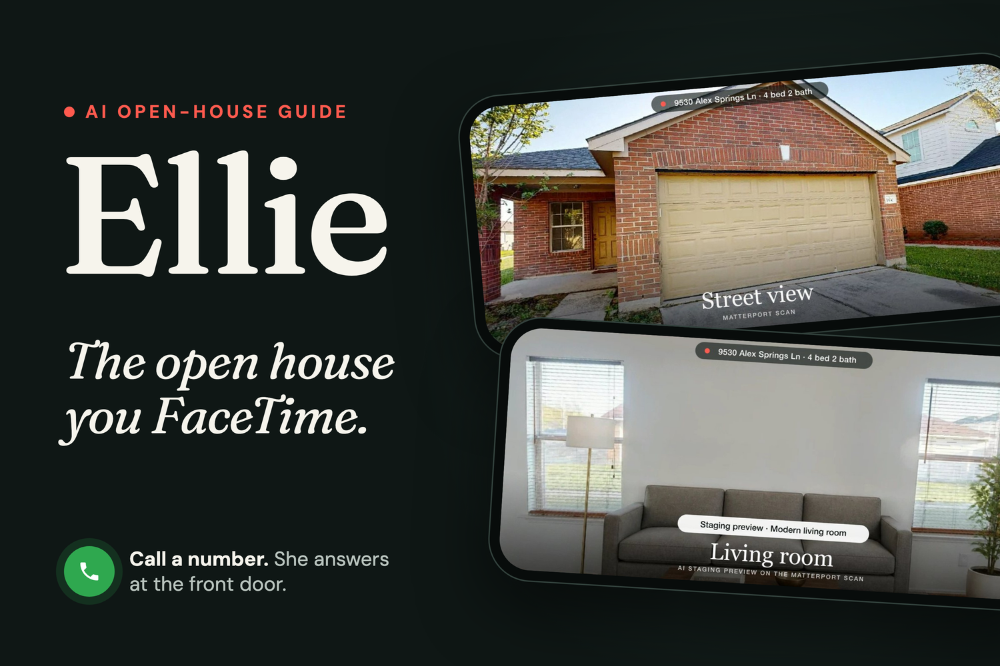
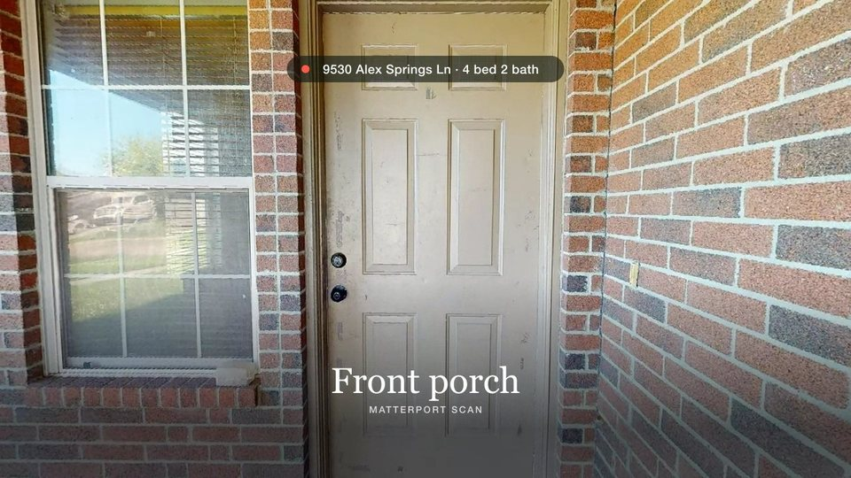
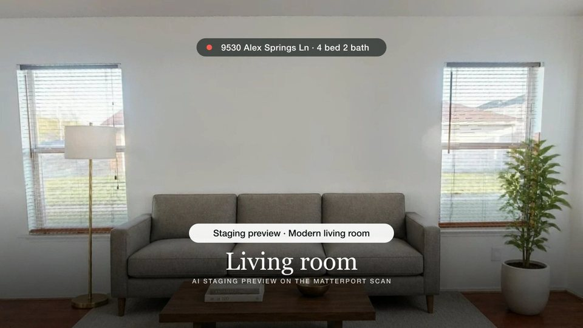
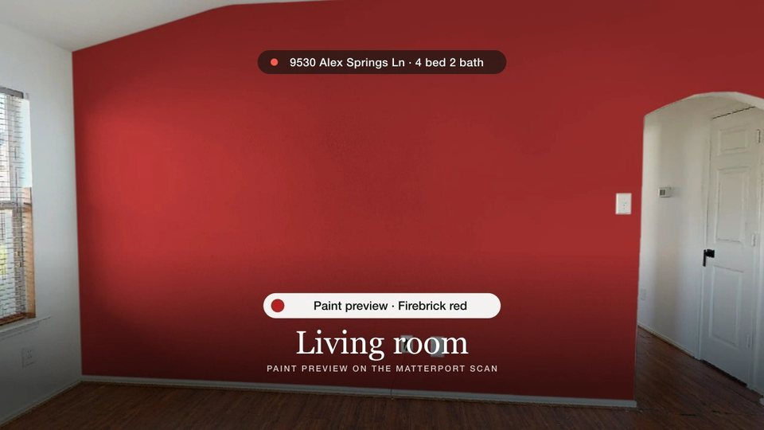
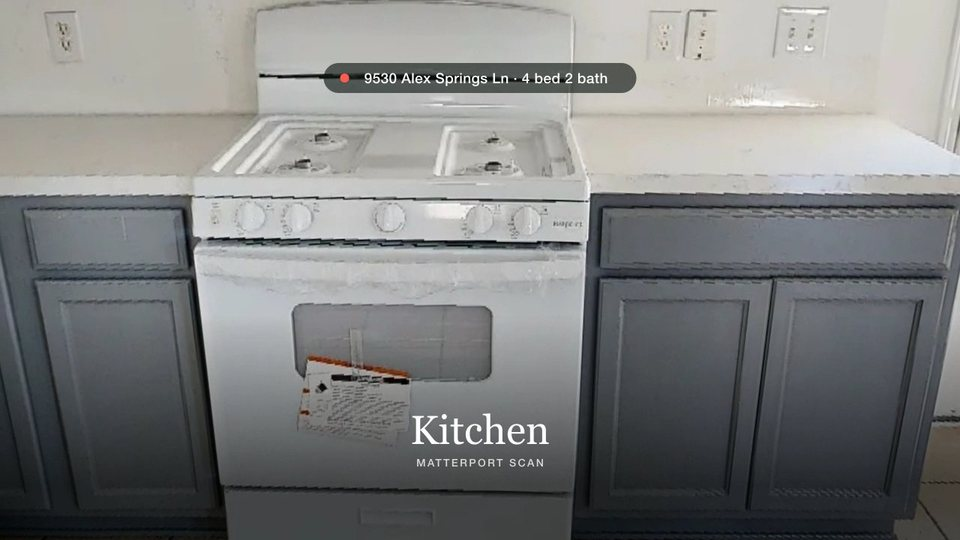
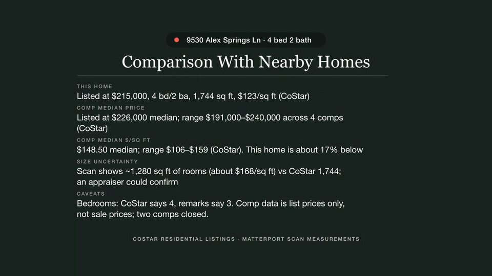
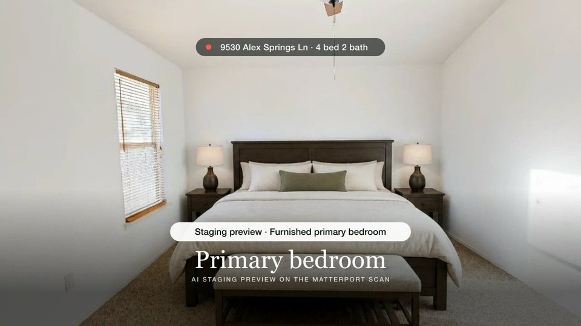
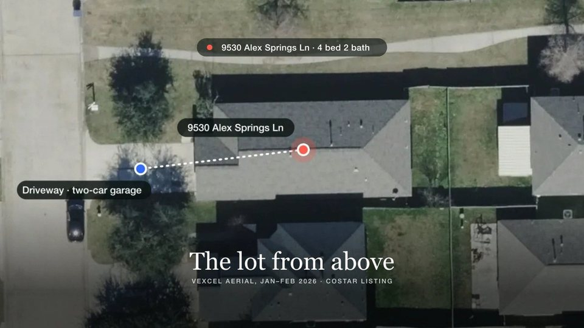
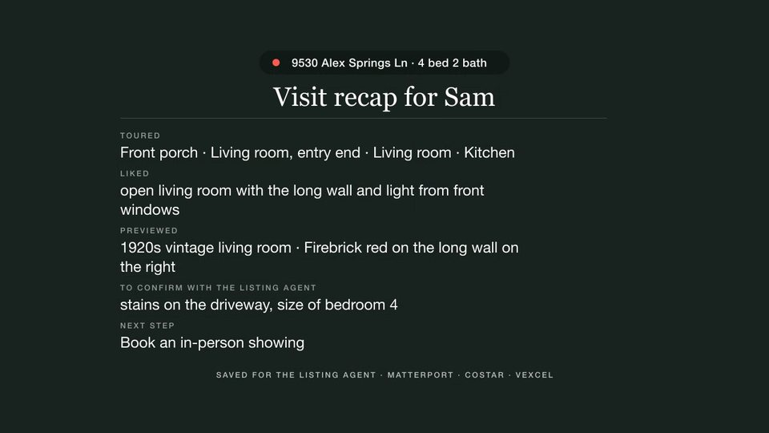
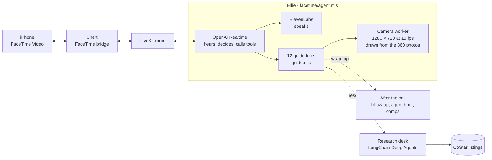

<p align="center">
  
</p>

# Ellie

**The open house you FaceTime.** Call a phone number and an AI guide answers at the front door of a real home for sale. She walks you through it on live video, answers from the listing record, repaints a wall or furnishes a room when you ask, and writes up the visit when you hang up.

> **Try it:** FaceTime Video **+1 (628) 233-9741** and hold your phone sideways.
> This is the demo line for HackPrinceton 2026. It answers one call at a time.

There is no app, no link and no headset. The picture is the listing's own Matterport photography, and what she says comes from the CoStar listing record, the scan's measurements and a Vexcel aerial.

## Why

Touring a home still means being there. A buyer moving to another city chooses from photos and a floor plan. An open house runs a few hours on a weekend, and the questions come on a weeknight. A private showing puts an agent and a stranger in an empty house. A 3D tour shows the rooms, but nobody is there to answer when you ask whether your desk fits by the window.

Ellie is the guide who is there: at any hour, from anywhere, on the phone you already have.

## A three-minute visit

Every frame below is from a real call to 9530 Alex Springs Lane, Houston.

| | | | |
|:--:|:--:|:--:|:--:|
| <br>**0:00** She answers at the door | <br>**0:30** “Furnish this room” | <br>**0:45** “Make that wall red” | <br>**1:00** “The stove, up close” |
| <br>**1:38** “How does it compare?” | <br>**1:45** “Put a bed in here” | <br>**2:20** “Show me from above” | <br>**2:50** “That’s all for today” |

The full script, with what each beat proves, is in [`Demo-Loop.md`](Demo-Loop.md).

## What she does

| Job | On the call |
| --- | --- |
| Greets and qualifies | Opens at the front door, asks what matters to you, and remembers it |
| Leads the walk | Plans a route from what you told her and walks it, room by room |
| Shows, then tells | Moves the camera first, turns once through each new room, then describes what is in frame |
| Follows directions | “Turn around”, “look up”, “go back to the kitchen”, “show me the house number” |
| Knows the listing | Price, taxes, HOA and remarks from the record; room sizes from the scan; the lot from the aerial |
| Changes the place | Paints a wall any colour, adds furniture, restyles a room, and calls each one a preview |
| Researches | Hands comparisons and payment questions to a team of agents, and keeps touring while they work |
| Takes interruptions | Stops when you talk over her and answers what you asked |
| Closes | Reads back a recap, records the next step, and leaves a brief for the listing agent |

She is also careful in the ways a licensed guide has to be. She says she is an AI when asked, names the source of a number, and never comments on who lives nearby, on safety, or on whether a school or an area is “good”.

## How it works



- **The call.** FaceTime reaches a LiveKit room through [Chert](https://www.trychert.com). The agent joins as one participant that publishes both the voice and the picture.
- **The voice.** OpenAI Realtime listens to the caller directly, decides when they have finished a thought, and calls tools. ElevenLabs speaks her words, with OpenAI's own voice as the backup if ElevenLabs is not answering.
- **The camera.** A worker thread draws every frame from the Matterport 360 photos: a free hand-held camera that walks between scan positions, turns through a room, and zooms on what she points at. The 3D mesh is never shown.
- **The tools.** `walk_to`, `plan_route`, `look_around`, `look`, `point_at`, `paint_wall`, `stage_room`, `clear_changes`, `show_outside`, `show_floor_plan`, `research` and `wrap_up`. Each returns what the camera now shows, and she talks only about that.
- **The changes.** Paint is a mask of the wall tinted so its light and shadows stay. Furniture is an image model working on the exact view, laid back onto the 360 photo so it stays put as the camera moves.

## The data

| Layer | What it gives her | Where you see it |
| --- | --- | --- |
| **Matterport** | The 360 photos she walks through, room boundaries and measurements | Every frame; 24 places to stand and 112 things to point at; the floor plan |
| **CoStar** | Price, taxes, HOA, remarks, and 2,120 listings to compare against | Spoken answers; the comparison card; the after-call packet |
| **Vexcel** | A 2026 aerial of the parcel and what was detected on it | The lot from above, about 40 by 110 feet, with the house and driveway marked |

### Where the sources disagree, she says so

The listing says 1,744 square feet. The scan measures about 1,280 square feet of rooms, plus a 367 square foot garage. She tells the buyer both and suggests an appraiser confirm the size. The same goes for the bedroom count (the remarks say three, the record and the scan show four) and the roof (a 2023 analysis flagged a tarp, the 2026 aerial shows even shingles). When something is not in the record at all, such as the flood zone, she says so and offers to confirm it with the listing agent.

## The research desk

The voice model has about two seconds to start answering, which is not enough to search two thousand listings. Questions like “how does this compare with similar homes nearby?” go to a [LangChain Deep Agent](https://docs.langchain.com/oss/javascript/deepagents/overview): a lead agent plans the work and hands it to two specialists, one that finds comparable homes and one that checks the listing against the scan. Ellie keeps touring, and about twenty seconds later the answer is on screen as a card and she says it aloud.

When the caller says goodbye, the same agents write three files: a follow-up for the buyer, a brief for the listing agent, and a table of comparable homes. The details, with real output, are in [`Deep-Agents-Pitch.md`](Deep-Agents-Pitch.md).

## Measured

| | Result | How it was measured |
| --- | --- | --- |
| First words after pickup | 0.8 to 1.9 s | Rehearsal calls |
| Reply, from the end of your sentence | About 2 s (1.7 to 2.4 s typical) | Rehearsal calls |
| After being interrupted | Stops at once; answers in 1.7 to 1.9 s | Rehearsal calls with a caller who talks over her |
| Picture | 1280 × 720 at 15 frames a second | Frames received by the caller |
| A researched comparison | 18 to 21 s | Calls with the research desk |
| After-call packet, three files | About 41 s | A run after the demo loop |

## Run it

The agent lives in [`facetime/`](facetime/). You need Node 22.23.2 or later, a [LiveKit Cloud](https://livekit.io) project, an OpenAI key with Realtime access, and a [Chert](https://www.trychert.com) line for real FaceTime calls.

```sh
cd facetime
npm install
cp .env.example .env.local && chmod 600 .env.local    # then fill it in privately

# terminal 1: the agent
OPEN_HOUSE_PROPERTY=alex-springs npm start

# terminal 2: the phone line
npx @trychert/facetime@0.1.0-beta.21 dev
```

When the second terminal says the agent is in a waiting room, make a FaceTime Video call to the number it shows.

| Setting in `.env.local` | Needed for |
| --- | --- |
| `LIVEKIT_URL`, `LIVEKIT_API_KEY`, `LIVEKIT_API_SECRET`, `OPENAI_API_KEY`, `AGENT_NAME` | Every call |
| `ELEVEN_API_KEY`, `ELEVEN_VOICE_ID` | Her ElevenLabs voice; without them OpenAI's voice speaks |
| `ANTHROPIC_API_KEY` | The research desk |
| `CHERT_API_KEY`, `CHERT_PROJECT_ID` | The text after a call |

**Without a phone.** `node --env-file=.env.local preview.mjs` puts the same call in a browser tab at [localhost:5190](http://localhost:5190). `node --env-file=.env.local rehearse.mjs out "Furnish this room." "^Wait, what's the price?"` plays a scripted caller (a line that starts with `^` is spoken over her) and saves what the caller would see and hear.

**The property data.** The 360 photos and the listings come from the HackPrinceton challenge kit and are not in this repository. `properties/<slug>/` holds what she knows about a home; `media/<slug>/` is built locally with `scripts/prepare_property.py <slug>`, then `make_walls.py`, `make_staging.mjs --property` and `make_depth.py`. More in [`facetime/README.md`](facetime/README.md).

<details>
<summary><b>The browser tour</b> (the first prototype, still in the repository root)</summary>

A web tour of the A5 apartment at The Parker at Ellington, with typed questions and a live voice.

```sh
npm ci
npm run dev
```

Open [localhost:5180](http://localhost:5180) in Chrome. The app serves prepared assets from `data/demo/`; the OpenAI key in the local `.env` enables typed questions and **Talk live**.

To prepare its data, use Node 22.12 or later, Blender 5.1, and Python with Pillow, NumPy and Shapely. The local `.env` supplies the Matterport API key and token and the Vexcel API key.

```sh
python3 -m pip install Pillow numpy shapely
npm run prepare:demo -- --live --kit /path/to/challenge-kit
```

Point `--kit` at the CoStar challenge export containing `data/apartment-listing.jsonl` and `data/commercial-property.jsonl`. Without `--live` the command reads the Matterport and Vexcel captures already cached. Use `--cache` or `--blender` to supply other paths.

For a screen-share rehearsal, open **FaceTime setup** and **Open tour window** on the Mac and share that window from the FaceTime menu bar ([Apple's guide](https://support.apple.com/en-mz/guide/facetime/fctmdcf2007a/mac)). For voice in that setup, route FaceTime's output and microphone through two [BlackHole](https://github.com/ExistentialAudio/BlackHole) loopback devices and match them under **Find audio devices** in the web app.

</details>

## Repository

| Path | What is there |
| --- | --- |
| [`facetime/`](facetime/) | Ellie: the call agent, her tools, the camera, paint and staging, the research desk, rehearsal tools |
| [`facetime/properties/`](facetime/properties/) | What she knows about each home: places, features, knowledge with sources |
| [`Demo-Loop.md`](Demo-Loop.md) | The three-minute demo, beat by beat, and the questions judges ask |
| [`Deep-Agents-Pitch.md`](Deep-Agents-Pitch.md) | The research desk: what the Deep Agent does, real output, how to run it |
| `src/`, `server/`, `shared/`, `scripts/` | The browser tour and the pipeline that prepares its data |
| [`docs/media/`](docs/media/) | The thumbnail and frames used on this page |

## Status

Ellie tours two homes today: the house at 9530 Alex Springs Lane and the A5 apartment at The Parker at Ellington. A new home needs its Matterport scan, its listing record and an aerial.

- **Works on real calls:** the two-way conversation, the walk, close-ups, paint, staging, the aerial, the floor plan, the research desk and the recap.
- **One call at a time,** five minutes a call, on a trial line.
- **Held sideways.** The picture is drawn for a phone held sideways. `TOUR_ORIENTATION=portrait` draws it for an upright phone, and choosing between them during a call is not built yet.
- **The text after a call** is wired through Chert but has not delivered yet: Chert does not tell an agent who called, and only texts phones that have joined the project.
- **Next:** send the follow-up packet to the buyer, remember a caller between visits, and prepare a new listing from its scan without hand-written notes.

## Built with

[Chert](https://www.trychert.com) for the FaceTime line, [LiveKit Agents](https://docs.livekit.io/agents/) for the call, OpenAI Realtime for hearing and deciding, ElevenLabs for her voice, OpenAI's image model for staging, and [LangChain Deep Agents](https://docs.langchain.com/oss/javascript/deepagents/overview) with Claude for the research desk. The home is from the CoStar, Matterport and Vexcel challenge data.

Built at HackPrinceton 2026.
